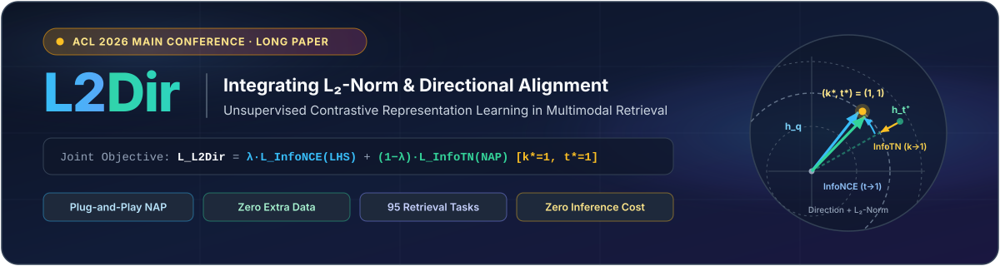
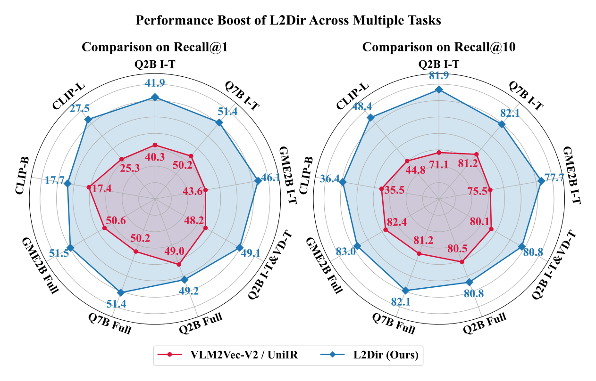
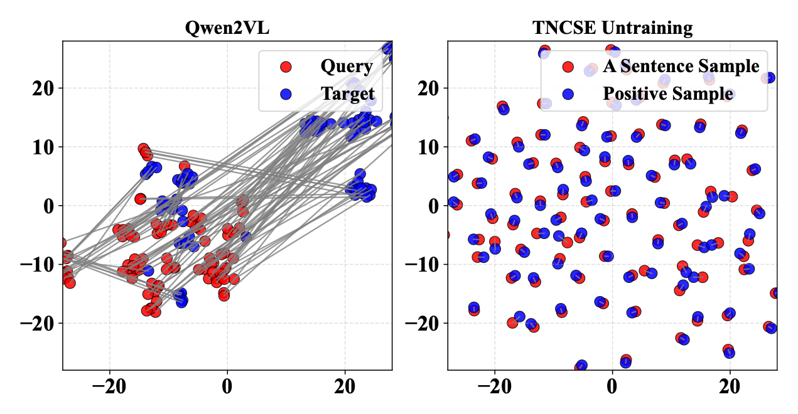
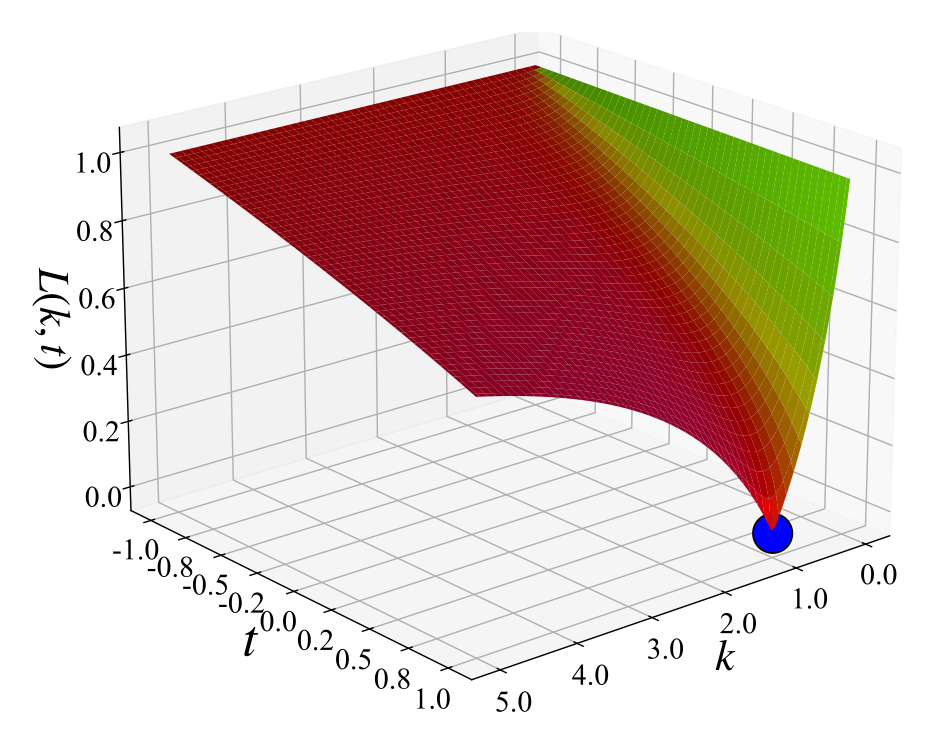
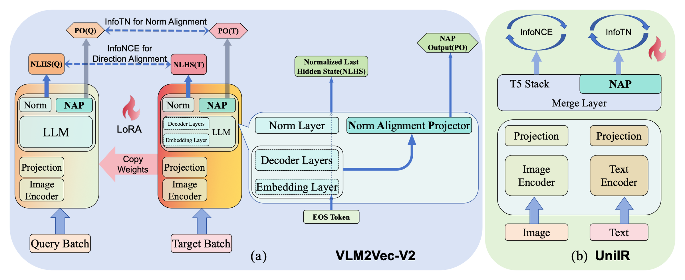
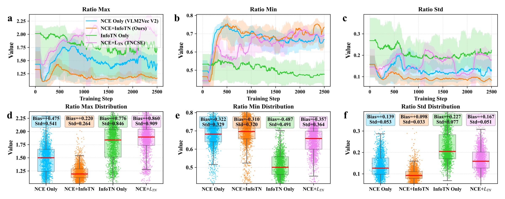
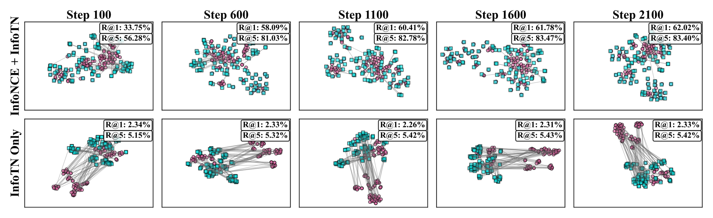

<div align="center">



<h1>L2Dir: Integrating L<sub>2</sub>-Norm and Directional Alignment for Unsupervised Contrastive Representation Learning in Multimodal Retrieval</h1>

<p>
  <a href="https://aclanthology.org/2026.acl-long.1604/"></a>
  <a href="https://aclanthology.org/2026.acl-long.1604.pdf"></a>
  <a href="https://doi.org/10.18653/v1/2026.acl-long.1604"></a>
  
  
</p>

<p>
  <b>🌐 English</b> &nbsp;|&nbsp; <a href="README_zh.md"><b>简体中文</b></a>
</p>

<p>
  <a href="#-overview--key-highlights">Overview</a> •
  <a href="#-motivation">Motivation</a> •
  <a href="#-methodology">Methodology</a> •
  <a href="#-experimental-results">Results</a> •
  <a href="#-training-dynamics--ablations">Dynamics &amp; Ablations</a> •
  <a href="#-repository-structure">Code Structure</a> •
  <a href="#-getting-started">Quick Start</a> •
  <a href="#-citation">Citation</a>
</p>

<p>
  <b>Tianyu Zong</b><sup>1,2</sup>,
  <b>Rui Dai</b><sup>2,*</sup>,
  <b>Hongzhu Yi</b><sup>1</sup>,
  <b>Yuanxiang Wang</b><sup>1</sup>,
  <b>Zhenghao Zhang</b><sup>1</sup>,
  <b>Zhenyu Guan</b><sup>3</sup>,<br/>
  <b>Yujia Yang</b><sup>3</sup>,
  <b>Bingkang Shi</b><sup>4</sup>,
  <b>Yueyang Ding</b><sup>2</sup>,
  <b>Xiangxiang Chu</b><sup>2</sup>,
  <b>Kaikui Liu</b><sup>2</sup>,
  <b>Jungang Xu</b><sup>1,*</sup>
</p>

<p>
  <sup>1</sup>School of Computer Science and Technology, University of Chinese Academy of Sciences (UCAS)<br/>
  <sup>2</sup>Amap, Alibaba Group<sup>†</sup> &nbsp;&nbsp;
  <sup>3</sup>Hangzhou Institute for Advanced Study, UCAS<br/>
  <sup>4</sup>School of Cyber Security, University of Chinese Academy of Sciences (UCAS)<br/>
  <sub><sup>*</sup>Co-corresponding authors &nbsp;·&nbsp; <sup>†</sup>Work conducted during internship at Amap, Alibaba Group</sub>
</p>

</div>

---

## 📢 News

- **[2026-07]** 🎉 Our paper is officially published in the *Proceedings of the 64th Annual Meeting of the Association for Computational Linguistics (Volume 1: Long Papers)*! Read it on [ACL Anthology (`2026.acl-long.1604`)](https://aclanthology.org/2026.acl-long.1604/) or download the [PDF](https://aclanthology.org/2026.acl-long.1604.pdf).
- **[2026-05]** 🚀 Released the official VLM training and MMEB-V2 evaluation codebase (`Qwen2-VL` + `InfoTN` + `GradCache`).
- **[2026-04]** 🎉 **L2Dir** is accepted to the **ACL 2026 Main Conference (Long Papers)**!

---

## ✨ Overview & Key Highlights

> [!IMPORTANT]
> **TL;DR:** Standard multimodal contrastive objectives (such as InfoNCE) project embeddings onto a unit hypersphere and optimize *directional* alignment alone—silencing the intrinsic semantic certainty and information density carried by embedding magnitudes ($`L_2`$-norm). **L2Dir** is a lightweight, plug-and-play framework that jointly optimizes **$`L_2`$-norm ranking (`InfoTN`)** and **directional consistency (`InfoNCE`)** via a parallel **Norm Alignment Projector (NAP)**—requiring **no extra data, no distillation, no external supervision, and zero extra inference cost**.

<p align="center">
  
</p>
<p align="center">
  <sub><b>Figure 1:</b> Recall@1 (left) and Recall@10 (right) gains of <b>L2Dir (Ours)</b> over baselines across all <b>9 evaluation scenarios</b>, spanning diverse backbones (<code>Qwen2-VL 2B/7B</code>, <code>GME 2B</code>, <code>CLIP-B/L</code>), retrieval paradigms (<code>VLM2Vec-V2</code>, <code>UniIR</code>), and training regimes (<code>I-T</code>, <code>I-T &amp; VD-T</code>, and <code>Full</code>).</sub>
</p>

### Why L2Dir?

- **🔌 Plug-and-Play & Ultra-Lightweight:** Attaches a simple feed-forward **Norm Alignment Projector (NAP)** in parallel with the final normalization layer, adding only **0.13%–0.58%** trainable parameters (e.g., `+0.05M` on `Qwen2-VL-2B` LoRA) without modifying backbone weights or requiring auxiliary supervision.
- **📐 Mathematically Grounded `InfoTN` Objective:** Reformulates tensor norm distance into a strictly bounded similarity metric $`\mathrm{sim}_{\text{TN}} \in [0, 1]`$ with analytically proven monotonicity and a unique global optimum at $`(k^*, t^*) = (1, 1)`$, overcoming the severe numerical divergence of unimodal norm constraints in multimodal spaces.
- **⚡ Zero Inference Overhead:** During training, `NAP` acts as a geometric regularizer that shapes a cleaner, better-structured representation space in the backbone's normalized last hidden states (`LHS`). At inference time, standard directional matching on `LHS` is used directly with **zero extra latency or memory**.
- **🏆 Consistent Gains Across 95 Multimodal Tasks:** Validated across **81 MMEB-V2 tasks** (Image-Text, Video-Text, and Visual Document-Text on `Qwen2-VL-2B/7B` and `GME-2B`) and **14 M-BEIR tasks** (`CLIP-B/L` under `UniIR`), including remarkable zero-shot cross-modal transfer (e.g., `+18.57` Hit@1 on ViDoRe-v1 for `Qwen2-VL-7B` trained only on Image-Text data).

---

## 🔍 Motivation

Why do unimodal norm-constraint methods (such as TNCSE's $`L_{\text{TN}}`$) fail when applied directly to Vision-Language Models?

<table>
  <tr>
    <td width="52%" align="center" valign="middle">
      
    </td>
    <td width="48%" align="center" valign="middle">
      
    </td>
  </tr>
  <tr>
    <td align="left" valign="top">
      <sub><b>Figure 2 — Severe Initial Modal Separation:</b> Unlike unimodal text encoders (right, <code>TNCSE</code>) where positive pairs are evenly distributed, initial <code>Qwen2-VL-2B</code> query and target embeddings (left) segregate into distant clusters. Directly minimizing raw norm differences across this modal chasm causes persistent norm-ratio instability.</sub>
    </td>
    <td align="left" valign="top">
      <sub><b>Figure 3 — Well-Behaved Bivariate Landscape:</b> Expressed over norm ratio <code>k = ||h_t|| / ||h_q||</code> and cosine similarity <code>t = cos(&gamma;)</code>, <code>L_TN(k, t)</code> exhibits complementary gradient dominance in <code>t</code> (red) and <code>k</code> (green), guiding positive pairs smoothly toward the unique global optimum <b><code>(k*, t*) = (1, 1)</code></b>.</sub>
    </td>
  </tr>
</table>

Furthermore, modern Transformer backbones terminate with `RMSNorm` or `LayerNorm`, causing a **geometric silencing effect** that clips embedding norms and decouples magnitude from semantic saliency. **L2Dir** resolves both challenges simultaneously: it reconstructs unclipped norm features via a decoupled projector (**NAP**) and optimizes *relative norm ranking* across in-batch negatives via **InfoTN**.

---

## 🧠 Methodology

<p align="center">
  
</p>
<p align="center">
  <sub><b>Figure 4:</b> Overall architecture of <b>L2Dir</b> instantiated on two multimodal retrieval paradigms: <b>(a) VLM-based retrieval (VLM2Vec-V2)</b> with EOS token pooling and parallel <code>RMSNorm</code> + <code>NAP</code> branches; <b>(b) Twin-Tower retrieval (UniIR)</b> with CLIP encoders, T5 Merge Layer, and parallel <code>LayerNorm</code> + <code>NAP</code> branches.</sub>
</p>

### 1. Bounded Tensor Norm Similarity ($`\mathrm{sim}_{\text{TN}}`$)

Given a query representation $`\mathbf{h}_q`$ and target representation $`\mathbf{h}_t`$ with norm ratio $`k = \Vert\mathbf{h}_t\Vert / \Vert\mathbf{h}_q\Vert \in (0, \infty)`$ and cosine similarity $`t = \cos\gamma \in [-1, 1]`$, the bivariate tensor norm dissimilarity $`L_{\text{TN}}`$ is formulated via the Law of Cosines as:

$$
L_{\text{TN}}(\mathbf{h}_q, \mathbf{h}_t) = \frac{\Vert \mathbf{h}_q - \mathbf{h}_t\Vert}{\Vert \mathbf{h}_q\Vert+ \Vert \mathbf{h}_t\Vert} = \frac{\sqrt{1 + k^2 - 2kt}}{1 + k} \in [0, 1]
$$

As proven in Appendices A & B of the paper, $`L_{\text{TN}}(k, t)`$ is strictly bounded in $`[0, 1]`$, monotonically decreasing with respect to $`t`$, and achieves its unique global minimum $`L_{\text{TN}}(k^*, t^*) = 0`$ if and only if $`(k^*, t^*) = (1, 1)`$ (simultaneous magnitude and directional alignment). Converting dissimilarity into a bounded similarity score yields:

$$
\mathrm{sim}_{\text{TN}}(\mathbf{h}_q, \mathbf{h}_t) = 1 - L_{\text{TN}}(\mathbf{h}_q, \mathbf{h}_t) \in [0, 1]
$$

### 2. Contrastive Norm Ranking (`InfoTN`) & Joint `L2Dir` Optimization

Instead of forcing rigid unit-norm regularization, **L2Dir** performs in-batch contrastive ranking in the $`L_2`$-norm similarity space alongside standard directional InfoNCE over in-batch targets $`\mathbb{D}`$:

$$
\mathcal{L}_{\text{NCE}}(\mathbf{h}_q, \mathbf{h}_t^+) = -\log \frac{\exp(\mathrm{sim}(\mathbf{h}_q, \mathbf{h}_t^+) / \tau)}{\sum_{\mathbf{h}_t^j \in \mathbb{D}} \exp(\mathrm{sim}(\mathbf{h}_q, \mathbf{h}_t^j) / \tau)}, \qquad
\mathcal{L}_{\text{InfoTN}}(\mathbf{h}_q, \mathbf{h}_t^+) = -\log \frac{\exp(\mathrm{sim}_{\text{TN}}(\mathbf{h}_q, \mathbf{h}_t^+) / \tau_{\text{TN}})}{\sum_{\mathbf{h}_t^j \in \mathbb{D}} \exp(\mathrm{sim}_{\text{TN}}(\mathbf{h}_q, \mathbf{h}_t^j) / \tau_{\text{TN}})}
$$

To prevent `RMSNorm` / `LayerNorm` from clipping magnitude signals, **Norm Alignment Projector (NAP)** branches immediately before the final normalization layer to produce unnormalized projector outputs $`\mathbf{PO}`$, while the normalized Last Hidden States $`\mathbf{LHS}`$ preserve clean directional features. Both negative log-likelihood objectives are optimized jointly ($`\lambda = 0.5`$ across all settings):

$$
\mathcal{L}_{\text{L2Dir}} = \lambda \cdot \mathcal{L}_{\text{NCE}}\left(\mathbf{LHS}_q, \mathbf{LHS}_t^+\right) + (1 - \lambda) \cdot \mathcal{L}_{\text{InfoTN}}\left(\mathbf{PO}_q, \mathbf{PO}_t^+\right)
$$

---

## 📊 Experimental Results

### 1. VLM-Based Multimodal Retrieval on MMEB-V2 (81 Tasks)

We evaluate **L2Dir** integrated into **VLM2Vec-V2** across **81 tasks** spanning **Image-Text (36 tasks: CLS, GD, QA, RET)**, **Video-Text (18 tasks: CLS, MRET, QA, RET)**, and **VisDoc-Text (27 tasks: OOD, VDRv1, VDRv2, VR)** under three progressive training regimes:
1. **I-T Only** (trained solely on Image-Text pairs; evaluates *zero-shot generalization* to Video-Text and VisDoc-Text),
2. **I-T + VD-T** (joint Image-Text & VisDoc-Text training; zero-shot on Video-Text),
3. **Full Dataset** (all modalities).

| Training Setting | Backbone | Method | I-T (CLS / GD / QA / RET) | V-T (CLS / MRET / QA / RET) | VD-T (OOD / VDRv1 / VDRv2 / VR) | All Hit@1 | MRR@1 / NDCG@1 | Avg R@1 / R@5 / R@10 |
| :--- | :--- | :--- | :---: | :---: | :---: | :---: | :---: | :---: |
| **I-T Only** *(Zero-Shot V-T & VD-T)* | `Qwen2-VL-2B` | VLM2Vec-V2 | 63.36 / 75.40 / 56.43 / 66.21 | 34.27 / 30.42 / **31.65** / 23.85 | **29.15** / **18.33** / 13.76 / 37.09 | 42.63 | 42.6 / 42.2 | 40.3 / 63.5 / 71.1 |
| **I-T Only** *(Zero-Shot V-T & VD-T)* | `Qwen2-VL-2B` | **+ L2Dir (Ours)** | **64.00** / **76.63** / **57.52** / **67.81** | **34.68** / **36.43** / 31.01 / **25.45** | 26.65 / 18.00 / **14.78** / **45.32** | **43.98** | **44.0 / 43.6** | **41.9 / 64.7 / 81.9** |
| **I-T Only** *(Zero-Shot V-T & VD-T)* | `Qwen2-VL-7B` | VLM2Vec-V2 | **66.23** / 78.70 / 56.78 / **70.11** | 42.71 / **42.52** / 30.84 / **32.63** | 34.39 / 20.58 / 12.43 / **58.59** | 47.24 | 47.2 / 46.7 | 44.9 / 67.2 / 74.1 |
| **I-T Only** *(Zero-Shot V-T & VD-T)* | `Qwen2-VL-7B` | **+ L2Dir (Ours)** | 65.95 / **78.73** / **57.61** / 70.02 | **43.31** / 41.06 / **32.50** / 32.48 | **37.43** / **39.15** / **20.29** / 57.63 | **50.42** | **50.4 / 49.9** | **47.5 / 71.5 / 78.6** |
| **I-T Only** *(Zero-Shot V-T & VD-T)* | `GME-2B` | VLM2Vec-V2 | **62.14** / 73.08 / **56.05** / 67.83 | 30.20 / 37.20 / 29.94 / 24.30 | 34.40 / 37.49 / 26.36 / 43.56 | 46.67 | 46.7 / 46.2 | 43.6 / 68.3 / 75.5 |
| **I-T Only** *(Zero-Shot V-T & VD-T)* | `GME-2B` | **+ L2Dir (Ours)** | 61.49 / **74.65** / 55.78 / **69.46** | **33.53** / **37.97** / **30.38** / **24.74** | **35.76** / **49.48** / **32.24** / **48.21** | **49.57** | **49.6 / 49.0** | **46.1 / 70.5 / 77.7** |
| **I-T + VD-T** *(Zero-Shot V-T)* | `Qwen2-VL-2B` | VLM2Vec-V2 | **64.07** / 76.55 / 56.47 / 67.44 | **38.40** / 36.18 / 32.08 / **26.41** | 36.95 / 51.05 / **36.37** / 63.32 | 51.93 | 51.9 / 51.4 | 48.2 / 73.0 / 80.1 |
| **I-T + VD-T** *(Zero-Shot V-T)* | `Qwen2-VL-2B` | **+ L2Dir (Ours)** | 63.88 / **79.83** / **57.30** / **68.18** | 37.18 / **38.44** / **32.56** / 26.03 | **38.05** / **53.88** / 35.55 / **64.16** | **52.70** | **52.7 / 52.1** | **49.1 / 73.4 / 80.8** |
| **Full Dataset** | `Qwen2-VL-2B` | VLM2Vec-V2 | 64.02 / 75.33 / **56.89** / 67.57 | 37.34 / 32.89 / 33.17 / 26.32 | **38.00** / **54.51** / 38.59 / 68.36 | 52.86 | 52.7 / 52.3 | 49.0 / 73.7 / 80.5 |
| **Full Dataset** | `Qwen2-VL-2B` | **+ L2Dir (Ours)** | **64.39** / **77.28** / 56.10 / **67.86** | **40.47** / **33.94** / **33.83** / **28.62** | 35.75 / 51.31 / **39.83** / **70.12** | **53.09** | **53.1 / 52.6** | **49.2 / 73.7 / 80.8** |
| **Full Dataset** | `Qwen2-VL-7B` | VLM2Vec-V2 | 63.48 / 74.85 / 56.23 / **69.38** | 40.43 / **39.90** / 33.73 / **30.78** | 40.90 / 56.76 / 32.43 / 73.08 | 53.95 | 54.0 / 53.4 | 50.2 / 74.4 / 81.2 |
| **Full Dataset** | `Qwen2-VL-7B` | **+ L2Dir (Ours)** | **64.82** / **79.50** / **57.17** / 69.18 | **41.01** / 37.16 / **35.61** / 30.49 | **41.95** / **58.84** / **42.90** / **74.71** | **55.80** | **55.8 / 55.2** | **51.4 / 75.2 / 82.1** |
| **Full Dataset** | `GME-2B` | VLM2Vec-V2 | 61.71 / 76.23 / **57.14** / 69.20 | 36.43 / 34.15 / 32.79 / 25.09 | 41.14 / **67.49** / 43.29 / **66.34** | 54.79 | 54.8 / 54.2 | 50.6 / 75.5 / 82.4 |
| **Full Dataset** | `GME-2B` | **+ L2Dir (Ours)** | **63.20** / **78.33** / 57.09 / **70.73** | **39.31** / **37.00** / **33.99** / **27.27** | **41.39** / 67.28 / **46.01** / 65.49 | **55.95** | **56.0 / 55.4** | **51.5 / 76.3 / 83.0** |

### 2. Twin-Tower Multimodal Retrieval on M-BEIR (14 Tasks via UniIR)

Applied to CLIP ViT-B/32 and ViT-L/14 backbones under **UniIR** feature fusion, **L2Dir** consistently boosts cross-modal retrieval across 14 M-BEIR tasks:

| Backbone | Method | 14-Task Avg Recall@1 | 14-Task Avg Recall@10 | Gain (@1 / @10) |
| :--- | :--- | :---: | :---: | :---: |
| `CLIP ViT-B/32` | UniIR-B | 17.4 | 35.5 | — |
| `CLIP ViT-B/32` | **L2Dir-B (Ours)** | **17.7** | **36.4** | **+0.3 / +0.9** |
| `CLIP ViT-L/14` | UniIR-L | 25.3 | 44.8 | — |
| `CLIP ViT-L/14` | **L2Dir-L (Ours)** | **27.5** | **48.4** | **+2.2 / +3.6** |

<details>
<summary><b>📋 Click to expand detailed 14-task M-BEIR breakdown (Table 1, Top)</b></summary>

<br/>

**Part A: `T-I`, `T-IT`, and `IT-T` Tasks**

| Model | VisualNews (T-I) @1/@10 | MSCOCO (T-I) @1/@10 | Fashion200k (T-I) @10/@50 | EDIS (T-IT) @1/@10 | WebQA (T-IT) @1/@10 | OVEN (IT-T) @1/@10 | InfoSeek (IT-T) @1/@10 |
| :--- | :---: | :---: | :---: | :---: | :---: | :---: | :---: |
| UniIR-B | 4.46 / 16.83 | 30.01 / 71.20 | 3.96 / 13.09 | 17.68 / 44.96 | **34.61 / 70.89** | 9.80 / 32.00 | **6.60** / 20.90 |
| **L2Dir-B** | **4.77 / 19.12** | **31.11 / 71.73** | **4.54 / 13.44** | **18.02 / 47.30** | 32.90 / 68.58 | **10.10 / 33.50** | 6.50 / **21.00** |
| UniIR-L | 8.07 / 26.90 | 44.26 / 83.28 | 9.66 / 23.79 | 21.01 / 53.22 | **44.60 / 79.73** | 17.05 / 42.10 | 8.28 / 24.68 |
| **L2Dir-L** | **12.37 / 36.20** | **46.25 / 84.24** | **11.05 / 25.13** | **21.78 / 57.11** | 38.15 / 76.18 | **21.82 / 50.07** | **11.95 / 32.82** |

**Part B: `I-T`, `IT-I`, and `IT-IT` Tasks**

| Model | VisualNews (I-T) @1/@10 | MSCOCO (I-T) @1/@10 | FashionIQ (IT-I) @10/@50 | Fashion200k (IT-I) @10/@50 | CIRR (IT-I) @1/@10 | OVEN (IT-IT) @1/@10 | InfoSeek (IT-IT) @1/@10 |
| :--- | :---: | :---: | :---: | :---: | :---: | :---: | :---: |
| UniIR-B | 4.32 / 16.96 | **43.20** / 81.04 | 4.81 / 14.32 | 11.48 / 26.07 | **5.95 / 37.15** | 24.06 / 51.50 | 10.82 / 33.89 |
| **L2Dir-B** | **4.78 / 18.83** | 43.06 / **81.60** | **5.11 / 15.14** | **11.83 / 27.52** | 5.18 / 36.93 | **26.55 / 53.37** | **11.31 / 36.65** |
| UniIR-L | 7.84 / 26.46 | 59.50 / 92.08 | 9.88 / 24.69 | 18.94 / 36.93 | **10.26 / 50.07** | 38.13 / 65.04 | 19.04 / 45.03 |
| **L2Dir-L** | **12.50 / 36.30** | **62.52 / 92.28** | **10.86 / 27.06** | **19.67 / 38.11** | 7.91 / 45.56 | **43.95 / 71.29** | **23.77 / 54.55** |

</details>

### 3. Parameter Efficiency & Semantic Saliency Recovery

| Metric / Property | CLIP-B | CLIP-L | Qwen2-VL 2B | Qwen2-VL 7B | GME 2B |
| :--- | :---: | :---: | :---: | :---: | :---: |
| Base Trainable Params | 158.36M | 438.04M | 9.20M *(LoRA)* | 20.51M *(LoRA)* | 9.20M *(LoRA)* |
| **Added NAP Params** | **+0.26M** | **+0.59M** | **+0.05M** | **+0.12M** | **+0.05M** |
| **Relative Parameter Overhead** | **0.17%** | **0.13%** | **0.55%** | **0.58%** | **0.55%** |
| **Avg Recall@10 Gain** | **+0.90%** | **+3.60%** | **+10.80%** | **+0.90%** | **+2.20%** |
| **Extra Inference Latency / Params** | **0** | **0** | **0** | **0** | **0** |

Beyond retrieval accuracy, Pearson correlation analysis on 50K Wikipedia samples (Table 6) demonstrates that `InfoTN` substantially restores the coupling between embedding magnitude and **semantic information density**: Word Entropy correlation improves **3.1×** (`r = +0.069` → **`+0.216`**), Character Entropy improves **1.7×** (`+0.191` → **`+0.328`**), Digit Count rises (`+0.094` → **`+0.162`**), while sensitivity to redundant Stopword Ratio drops (`-0.149` → **`-0.042`**).

---

## 📈 Training Dynamics & Ablations

<p align="center">
  
</p>
<p align="center">
  <sub><b>Figure 5 — Optimization Stability:</b> Evolution and statistical distributions of positive-pair norm ratios (<code>||h_q|| / ||h_t⁺||</code>). Compared with <code>NCE Only</code>, <code>InfoTN Only</code>, and unimodal <code>NCE + L_TN</code>, our <b><code>InfoNCE + InfoTN</code></b> achieves the tightest 5th–95th percentile band, lowest deviation (<code>Std=0.033</code>), and smallest bias toward the ideal equilibrium <code>1.0</code>.</sub>
</p>

<p align="center">
  
</p>
<p align="center">
  <sub><b>Figure 6 — Progressive Cross-Modal Alignment:</b> t-SNE snapshots from Step 100 to Step 2100. Without <code>InfoNCE</code>'s negative-pair repulsion (bottom), <code>InfoTN Only</code> suffers representation collapse; combining <b><code>InfoNCE + InfoTN</code></b> (top) steadily bridges modal separation and boosts 36-task Image-Text Recall@1 from <code>33.75%</code> to <b><code>62.02%</code></b> (reaching <b><code>64.9%</code></b> at convergence vs. <code>63.7%</code> baseline).</sub>
</p>

---

## 📂 Repository Structure

This repository provides the official **VLM training and evaluation implementation** of **L2Dir** built upon the [VLM2Vec](https://github.com/TIGER-AI-Lab/VLM2Vec) pipeline.

```text
L2Dir_ACL2026/
├── assets/                                     # Paper figures & visual assets for documentation
├── configs/
│   ├── train_image.yaml                        # Image-only MMEB training dataset config template
│   └── eval_image.yaml                         # Image-only MMEB-V2 evaluation dataset config template
├── scripts/
│   ├── train_qwen2vl_2b_imageonly.sh           # 8-GPU LoRA + L2Dir training launcher (Qwen2-VL-2B)
│   └── eval_qwen2vl_2b_image_8gpu.sh           # 8-GPU distributed MMEB-V2 evaluation launcher
├── src/
│   ├── loss.py                                 # Core InfoTNLoss, DistributedInfoTNLoss, sim_TN & dynamics logger
│   ├── trainer.py                              # Custom HuggingFace trainer orchestrating dual-stream GradCache
│   ├── arguments.py                            # Model, Data, Training, and MTEB/MMEB CLI dataclasses
│   ├── grad_cache/
│   │   └── grad_cache.py                       # Memory-efficient GradCache supporting normalized + unnorm streams
│   ├── model/
│   │   ├── model.py                            # MMEBModel wrapper with EOS pooling (_pooling & _pooling_unnorm)
│   │   ├── processor.py                        # Multi-backbone processor & token registries
│   │   ├── vlm_backbone/                       # Qwen2-VL & Qwen2.5-VL backbones with unnormalized hidden state outputs
│   │   └── baseline_backbone/                  # Baseline adapters (GME, LamRA, ColPali, LLaVA-NeXT, Phi-3.5-V)
│   ├── data/                                   # Dataset loaders, multimodal collators, and visual transforms
│   ├── prompt/                                 # Task-specific instruction prompt templates
│   └── eval_utils/                             # Retrieval indexing and Hit@K / Recall@K / MRR / NDCG metrics
├── train.py                                    # Main training entry point
├── eval.py                                     # Main evaluation entry point
├── env.example                                 # Environment variable template (safe placeholder configuration)
└── requirements.txt                            # Python package dependencies
```

### Core Paper-to-Code Mapping

| Paper Component | Implementation Location | Description |
| :--- | :--- | :--- |
| **$`\mathrm{sim}_{\text{TN}}`$ & $`\mathcal{L}_{\text{InfoTN}}`$** (Eq. 4, 7) | [`src/loss.py`](src/loss.py) (`InfoTNLoss`, `DistributedInfoTNLoss`) | Computes pairwise norm-aware similarity `1 - ||h_q - h_t|| / (||h_q|| + ||h_t||)`, contrastive loss, and analytical $`\partial L / \partial k, \partial L / \partial t`$ diagnostics. |
| **Dual-Stream Hidden States** (Sec. 3.3) | [`src/model/vlm_backbone/qwen2_vl/modeling_qwen2_vl_copy.py`](src/model/vlm_backbone/qwen2_vl/modeling_qwen2_vl_copy.py) | Exports both RMSNorm-normalized `last_hidden_state` (`LHS`) and pre-norm / unnormalized hidden states (`last_hidden_states_unnorm`). |
| **EOS Token Pooling** (Fig. 4a) | [`src/model/model.py`](src/model/model.py) (`MMEBModel.encode_input`) | Extracts EOS-pooled normalized embeddings (`_pooling`) for $`\mathcal{L}_{\text{NCE}}`$ and unnormalized embeddings (`_pooling_unnorm`) for $`\mathcal{L}_{\text{InfoTN}}`$. |
| **Large-Batch Dual-Stream GradCache** | [`src/grad_cache/grad_cache.py`](src/grad_cache/grad_cache.py) | Caches gradients across both normalized (`get_rep_fn`) and unnormalized (`get_rep_fn_unnorm`) representation streams to scale effective batch size (e.g., 1024). |

---

## 🚀 Getting Started

### 1. Environment Installation

Create a compatible Python / CUDA environment (the original VLM experiments used a conda environment named `vlm2v`) and install the dependencies in `requirements.txt`:

```bash
conda create -n vlm2v python=3.10 -y
conda activate vlm2v

pip install -r requirements.txt
# Optional (recommended for Qwen2-VL FlashAttention-2 acceleration):
# pip install flash-attn --no-build-isolation
```

> [!NOTE]
> **GME Baseline Environment:** GME baselines are **not** expected to run inside this VLM2Vec environment. To run GME models, please configure a separate environment following the official GME repository and its pinned dependency versions.

### 2. Data & Environment Configuration

All training and evaluation scripts read local dataset directories, model paths, and output directories from environment variables so that no machine-specific paths or private credentials are ever hard-coded. Review [`env.example`](env.example) before running:

| Variable | Required | Default | Description |
| :--- | :---: | :--- | :--- |
| `TRAIN_IMAGE_DIR` | **Train** | — | Local directory containing MMEB-train images ([TIGER-Lab/MMEB-train](https://huggingface.co/datasets/TIGER-Lab/MMEB-train)) |
| `EVAL_IMAGE_ROOT` | **Eval** | — | Local root directory of MMEB-V2 image evaluation tasks ([TIGER-Lab/MMEB-V2](https://huggingface.co/datasets/TIGER-Lab/MMEB-V2)) |
| `TRAIN_MODEL_NAME` | Optional | `Qwen/Qwen2-VL-2B-Instruct` | Hugging Face model ID or local path to the base VLM |
| `EVAL_MODEL_NAME` | **Eval** | — | Path to your trained L2Dir checkpoint or released model ID |
| `OUTPUT_DIR` | Optional | `./outputs/l2dir_vlm_qwen2vl_2b_imageonly` | Directory for saving training checkpoints, rendered YAML configs, and logs |
| `OUTPUT_BASEDIR` | Optional | `./outputs/eval_l2dir_vlm_qwen2vl_2b` | Directory for saving MMEB-V2 evaluation predictions and metric summaries |
| `NUM_GPUS` | Optional | `8` | Number of GPUs passed to `torchrun --nproc_per_node` |

> [!WARNING]
> **Security Reminder:** Never commit real Hugging Face tokens, W&B API keys, proxy URLs, or private account paths into tracked files. Configure `HF_HOME`, `HF_ENDPOINT`, or `WANDB_*` strictly in your own shell environment.

### 3. Training

Set your local MMEB training image directory and output path, then launch the 8-GPU Qwen2-VL-2B training script (the script automatically renders `configs/train_image.yaml` into `${OUTPUT_DIR}` before invoking `train.py`):

```bash
export TRAIN_IMAGE_DIR=/path/to/your/MMEB-train/images
export OUTPUT_DIR=/path/to/your/outputs/l2dir_qwen2vl_2b

bash scripts/train_qwen2vl_2b_imageonly.sh
```

Common hyperparameter and hardware overrides:

```bash
export TRAIN_MODEL_NAME=Qwen/Qwen2-VL-2B-Instruct
export CUDA_VISIBLE_DEVICES=0,1,2,3,4,5,6,7
export NUM_GPUS=8
export PER_DEVICE_TRAIN_BATCH_SIZE=64
export LEARNING_RATE=3e-5
export MAX_STEPS=1000          # Set to 5000 for full-schedule 2B experiments as in Appendix C.2
export REPORT_TO=tensorboard   # Or set REPORT_TO=wandb with WANDB_* configured in your shell
```

### 4. Evaluation

After training (note: this code release intentionally does not bundle pre-trained checkpoints), evaluate your checkpoint across the MMEB-V2 image benchmark:

```bash
export EVAL_MODEL_NAME=/path/to/your/trained-checkpoint
export EVAL_IMAGE_ROOT=/path/to/your/MMEB-V2/image-tasks
export OUTPUT_BASEDIR=/path/to/your/outputs/eval_l2dir_qwen2vl_2b

bash scripts/eval_qwen2vl_2b_image_8gpu.sh
```

Useful evaluation overrides:

```bash
export CUDA_VISIBLE_DEVICES=0,1,2,3,4,5,6,7
export NUM_GPUS=8
export BATCH_SIZE=16
export MODEL_BACKBONE=qwen2_vl
```

### 5. Reproducibility Note

- **YAML Config Templates:** Both `configs/train_image.yaml` and `configs/eval_image.yaml` are templates containing path placeholders (`{{MMEB_TRAIN_IMAGE_DIR}}`, etc.). The shell scripts in `scripts/` render concrete YAML files into your output directory automatically prior to launching `train.py` or `eval.py`.
- **Baseline Score Variance:** This public code release currently cannot reproduce the original VLM2Vec-V2 baseline scores to the exact decimal. The slight discrepancy may be related to `dataloader_num_workers` and installed `datasets` package versions; all comparisons in our paper were conducted under strictly identical local environments and hyperparameters for fairness.

---

## 📝 Citation

If you find **L2Dir** or our theoretical and empirical analysis of magnitude-direction alignment useful in your research, please cite our ACL 2026 paper:

```bibtex
@inproceedings{zong-etal-2026-l2dir,
    title = "{L}2{D}ir: Integrating $L_2$-Norm and Directional Alignment for Unsupervised Contrastive Representation Learning in Multimodal Retrieval",
    author = "Zong, Tianyu  and
      Dai, Rui  and
      Yi, Hongzhu  and
      Wang, Yuanxiang  and
      Zhang, Zhenghao  and
      Guan, Zhenyu  and
      Yang, Yujia  and
      Shi, Bingkang  and
      Ding, Yueyang  and
      Chu, Xiangxiang  and
      Liu, Kaikui  and
      Xu, Jungang",
    booktitle = "Proceedings of the 64th Annual Meeting of the Association for Computational Linguistics (Volume 1: Long Papers)",
    month = jul,
    year = "2026",
    address = "San Diego, California, United States",
    publisher = "Association for Computational Linguistics",
    url = "https://aclanthology.org/2026.acl-long.1604/",
    doi = "10.18653/v1/2026.acl-long.1604",
    pages = "34717--34740"
}
```

---

## 🙏 Acknowledgements & Contact

- Our VLM codebase builds upon the open-source [VLM2Vec / VLM2Vec-V2](https://github.com/TIGER-AI-Lab/VLM2Vec) and [UniIR](https://github.com/TIGER-AI-Lab/UniIR) frameworks from TIGER-AI-Lab, as well as [Qwen2-VL](https://github.com/QwenLM/Qwen2-VL) and [GradCache](https://github.com/luyug/GradCache). We sincerely thank the authors for their foundational contributions.
- We gratefully acknowledge Prof. Qian Sheng (North China University of Technology) for insightful guidance on theoretical derivations, and Baorong Liu and Likun Zhang for their assistance in source-code analysis and baseline reproduction.
- **Contact:** For questions or collaborations, please open a GitHub Issue or reach out to **Tianyu Zong** (`zongtianyu20@mails.ucas.ac.cn`), **Rui Dai** (`daima.dr@alibaba-inc.com`), or **Jungang Xu** (`xujg@ucas.ac.cn`).
