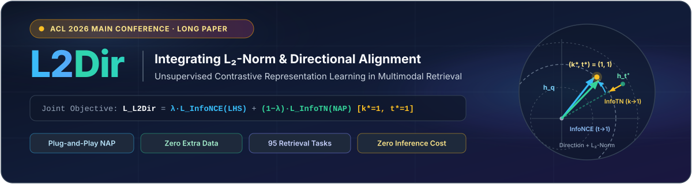
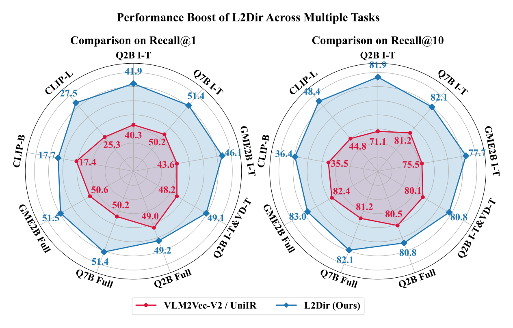
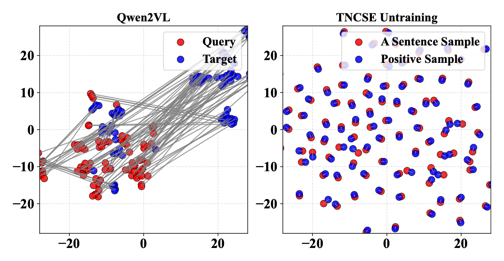
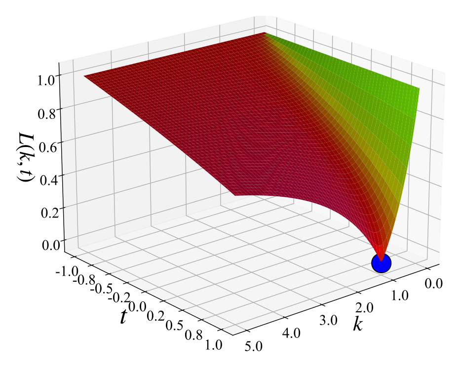
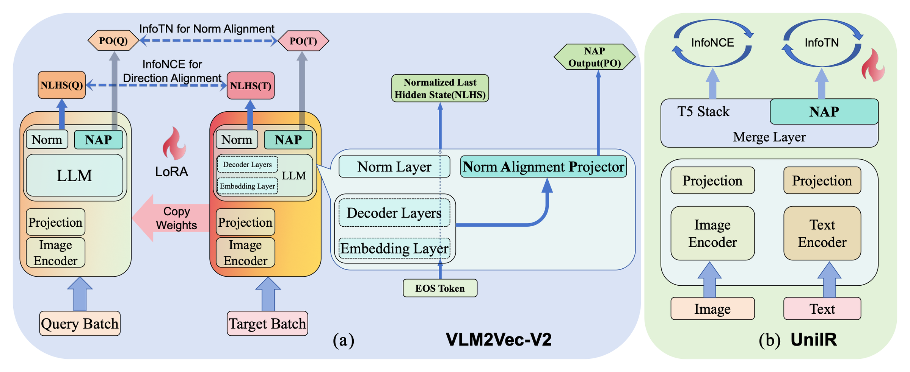
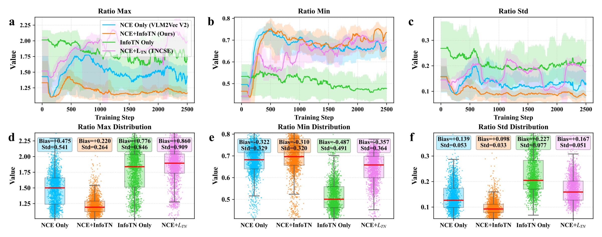
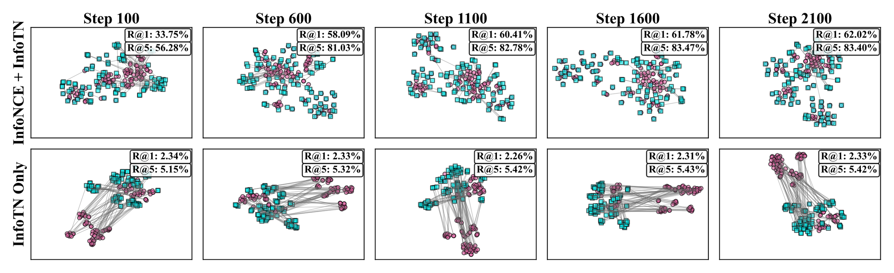

<div align="center">



<h1>L2Dir: Integrating L<sub>2</sub>-Norm and Directional Alignment for Unsupervised Contrastive Representation Learning in Multimodal Retrieval</h1>

<p>
  <a href="https://aclanthology.org/2026.acl-long.1604/"></a>
  <a href="https://aclanthology.org/2026.acl-long.1604.pdf"></a>
  <a href="https://doi.org/10.18653/v1/2026.acl-long.1604"></a>
  
  
</p>

<p>
  <a href="README.md"><b>🌐 English</b></a> &nbsp;|&nbsp; <b>简体中文</b>
</p>

<p>
  <a href="#-方法概览与核心亮点">核心亮点</a> •
  <a href="#-研究动机">研究动机</a> •
  <a href="#-核心方法">核心方法</a> •
  <a href="#-实验结果">实验结果</a> •
  <a href="#-训练动力学与消融分析">训练动力学</a> •
  <a href="#-仓库目录与源码映射">源码结构</a> •
  <a href="#-快速开始">快速开始</a> •
  <a href="#-引用格式">引用格式</a>
</p>

<p>
  <b>Tianyu Zong</b><sup>1,2</sup>,
  <b>Rui Dai</b><sup>2,*</sup>,
  <b>Hongzhu Yi</b><sup>1</sup>,
  <b>Yuanxiang Wang</b><sup>1</sup>,
  <b>Zhenghao Zhang</b><sup>1</sup>,
  <b>Zhenyu Guan</b><sup>3</sup>,<br/>
  <b>Yujia Yang</b><sup>3</sup>,
  <b>Bingkang Shi</b><sup>4</sup>,
  <b>Yueyang Ding</b><sup>2</sup>,
  <b>Xiangxiang Chu</b><sup>2</sup>,
  <b>Kaikui Liu</b><sup>2</sup>,
  <b>Jungang Xu</b><sup>1,*</sup>
</p>

<p>
  <sup>1</sup>中国科学院大学 计算机科学与技术学院 &nbsp;&nbsp;
  <sup>2</sup>阿里巴巴集团 高德地图<sup>†</sup><br/>
  <sup>3</sup>国科大杭州高等研究院 &nbsp;&nbsp;
  <sup>4</sup>中国科学院大学 网络空间安全学院<br/>
  <sub><sup>*</sup>共同通讯作者 &nbsp;·&nbsp; <sup>†</sup>本工作完成于阿里巴巴高德地图实习期间</sub>
</p>

</div>

---

## 📢 最新动态

- **[2026-07]** 🎉 论文已在 **ACL 2026 主会长文卷（Volume 1: Long Papers）**正式发表！欢迎访问 [ACL Anthology 官方页面 (`2026.acl-long.1604`)](https://aclanthology.org/2026.acl-long.1604/) 或直接阅读 [论文 PDF](https://aclanthology.org/2026.acl-long.1604.pdf)。
- **[2026-05]** 🚀 开源基于 VLM（`Qwen2-VL` + `InfoTN` + `GradCache`）的官方训练与 MMEB-V2 评测代码。
- **[2026-04]** 🎉 **L2Dir** 被自然语言处理国际顶会 **ACL 2026 主会（Main Conference, Long Papers）**录用！

---

## ✨ 方法概览与核心亮点

> [!IMPORTANT]
> **核心思想（TL;DR）：** 主流多模态无监督对比学习（如 InfoNCE）几乎只关注单位超球面上的**方向对齐**，而忽略了表征模长（$L_2$-norm）所承载的语义确定性与信息密度。**L2Dir** 提出了一种轻量级、即插即用的协同训练框架，通过并行的**范数对齐投影器（NAP）**与严格有界的对比损失 **InfoTN**，在**无需额外数据、无需知识蒸馏、无需外部监督且推理阶段零额外开销**的前提下，实现 $L_2$ 范数对齐与方向一致性的联合优化。

<p align="center">
  
</p>
<p align="center">
  <sub><b>图 1：</b><b>L2Dir（本文方法）</b>与基线模型在全部 <b>9 大评测场景</b>下的 Recall@1（左）与 Recall@10（右）雷达对比图，全面覆盖不同骨干网络（<code>Qwen2-VL 2B/7B</code>、<code>GME 2B</code>、<code>CLIP-B/L</code>）、不同检索范式（<code>VLM2Vec-V2</code>、<code>UniIR</code>）以及不同训练数据规模（<code>I-T</code>、<code>I-T &amp; VD-T</code> 与 <code>Full</code>）。</sub>
</p>

### 四大核心优势

- **🔌 即插即用、极低参数开销：** 在骨干网络末端归一化层旁并行接入轻量级前馈网络 **NAP（Norm Alignment Projector）**，仅增加 **0.13%–0.58%** 的可训练参数（例如在 `Qwen2-VL-2B` LoRA 上仅增加 `+0.05M` 参数），即可无缝接入现有双塔或 VLM 多模态检索管线。
- **📐 严格数学保证的 `InfoTN` 损失：** 将张量范数差异重构为严格有界于 $[0, 1]$ 的相似度度量 $\operatorname{sim}_{\text{TN}}$，从理论上证明了其关于方向余弦与模长比的单调性及唯一全局最优解 $(k^*, t^*) = (1, 1)$，彻底解决了单模态范数约束直接迁移至多模态场景时的数值振荡与不收敛问题。
- **⚡ 推理阶段零额外成本：** 训练时 `NAP` 作为几何结构正则化信号引导骨干网络的归一化隐状态（`LHS`）形成更具判别力的空间分布；推理检索时直接使用 `LHS` 计算余弦相似度，**不引入任何额外参数、显存或延迟开销**。
- **🏆 95 项多模态任务全面领先：** 在 **MMEB-V2（81 项图文/视频/视觉文档检索任务）** 与 **M-BEIR（14 项跨模态任务）** 上均取得稳定显著提升，尤其在零样本跨模态迁移场景表现突出（如 `Qwen2-VL-7B` 仅在图文数据训练时，零样本 `ViDoRe-v1` Hit@1 从 `20.58` 跃升至 **`39.15`**）。

---

## 🔍 研究动机

为什么单模态文本表征中的模长约束（如 TNCSE 的 $L_{\text{TN}}$）无法直接用于多模态视觉语言模型？

<table>
  <tr>
    <td width="52%" align="center" valign="middle">
      
    </td>
    <td width="48%" align="center" valign="middle">
      
    </td>
  </tr>
  <tr>
    <td align="left" valign="top">
      <sub><b>图 2 — 严重的初始模态分布鸿沟：</b>不同于单模态文本编码器（右，<code>TNCSE</code>）中正样本对均匀散布在整个空间，未经对齐的 <code>Qwen2-VL-2B</code> 查询与目标特征（左）在空间中高度聚簇且彼此远离。在此跨模态鸿沟下直接最小化原始模长差会导致正样本模长比剧烈震荡。</sub>
    </td>
    <td align="left" valign="top">
      <sub><b>图 3 — 互补协同的二维梯度场：</b>将损失表示为模长比 <code>k = ||h_t|| / ||h_q||</code> 与余弦相似度 <code>t = cos(&gamma;)</code> 的二元函数后，<code>t</code> 主导区（红）与 <code>k</code> 主导区（绿）提供互补且一致的梯度信号，共同推动正样本对收敛至唯一全局最优点 <b><code>(k*, t*) = (1, 1)</code></b>。</sub>
    </td>
  </tr>
</table>

此外，现代 Transformer 架构普遍采用 `RMSNorm` 或 `LayerNorm` 稳定训练，这会造成**“几何静默效应（Geometric Silencing）”**——特征向量的模长被强制裁剪，使其与文本信息熵、结构复杂度等语义显著性指标脱钩。**L2Dir** 从架构与目标函数两个层面同时切入：用解耦的 **NAP** 重构模长特征，并用批次内对比排序损失 **InfoTN** 替代刚性差值最小化。

---

## 🧠 核心方法

<p align="center">
  
</p>
<p align="center">
  <sub><b>图 4：</b><b>L2Dir</b> 在两类主流多模态架构上的整体实现：<b>(a) 基于 VLM 的检索框架（VLM2Vec-V2）</b>，采用 EOS Token 池化并在 <code>RMSNorm</code> 旁并行挂载 <code>NAP</code>；<b>(b) 基于双塔的检索框架（UniIR）</b>，在 CLIP 编码器与 T5 融合层末端与 <code>LayerNorm</code> 并行挂载 <code>NAP</code>。</sub>
</p>

### 1. 有界张量范数相似度（$\operatorname{sim}_{\text{TN}}$）

设正样本对中的查询特征为 $\mathbf{h}_q$、目标特征为 $\mathbf{h}_t$，定义模长比 $k = \|\mathbf{h}_t\| / \|\mathbf{h}_q\| \in (0, \infty)$，方向余弦相似度 $t = \cos\gamma \in [-1, 1]$。由余弦定理可将张量范数不相似度 $L_{\text{TN}}$ 化简为紧凑的二元形式：

$$
L_{\text{TN}}(\mathbf{h}_q, \mathbf{h}_t) = \frac{\|\mathbf{h}_q - \mathbf{h}_t\|}{\|\mathbf{h}_q\| + \|\mathbf{h}_t\|} = \frac{\sqrt{1 + k^2 - 2kt}}{1 + k} \in [0, 1]
$$

论文附录 A 与附录 B 严格证明了：$0 \le L_{\text{TN}}(k, t) \le 1$ 恒成立，且对 $t$ 严格单调递减，当且仅当 $(k^*, t^*) = (1, 1)$（模长与方向同时完美对齐）时取得唯一全局最小值 $0$。由此定义有界范数相似度：

$$
\operatorname{sim}_{\text{TN}}(\mathbf{h}_q, \mathbf{h}_t) = 1 - L_{\text{TN}}(\mathbf{h}_q, \mathbf{h}_t) \in [0, 1]
$$

### 2. 对比范数排序损失（`InfoTN`）与 `L2Dir` 联合训练目标

我们将优化重心从“直接缩小绝对范数差”转化为“在 $L_2$ 范数空间内对正负样本进行相对排序”，结合标准 InfoNCE 在批次候选集 $\mathbb{D}$ 上联合训练：

$$
\mathcal{L}_{\text{NCE}}(\mathbf{h}_q, \mathbf{h}_t^+) = -\log \frac{\exp(\operatorname{sim}(\mathbf{h}_q, \mathbf{h}_t^+) / \tau)}{\sum_{\mathbf{h}_t^j \in \mathbb{D}} \exp(\operatorname{sim}(\mathbf{h}_q, \mathbf{h}_t^j) / \tau)}, \qquad
\mathcal{L}_{\text{InfoTN}}(\mathbf{h}_q, \mathbf{h}_t^+) = -\log \frac{\exp(\operatorname{sim}_{\text{TN}}(\mathbf{h}_q, \mathbf{h}_t^+) / \tau_{\text{TN}})}{\sum_{\mathbf{h}_t^j \in \mathbb{D}} \exp(\operatorname{sim}_{\text{TN}}(\mathbf{h}_q, \mathbf{h}_t^j) / \tau_{\text{TN}})}
$$

在模型末端，归一化后的最后一层隐状态 $\mathbf{LHS}$ 输入 $\mathcal{L}_{\text{NCE}}$ 优化方向对齐；并行前馈网络 **NAP** 重构出的未裁剪模长表征 $\mathbf{PO}$ 专用于计算 $\mathcal{L}_{\text{InfoTN}}$（全文统一取 $\lambda = 0.5$）：

$$
\mathcal{L}_{\text{L2Dir}} = \lambda \cdot \mathcal{L}_{\text{NCE}}\!\left(\mathbf{LHS}_q, \mathbf{LHS}_t^+\right) + (1 - \lambda) \cdot \mathcal{L}_{\text{InfoTN}}\!\left(\mathbf{PO}_q, \mathbf{PO}_t^+\right)
$$

---

## 📊 实验结果

### 1. VLM 多模态检索主实验：MMEB-V2（81 项任务）

我们在 **VLM2Vec-V2** 框架下评测了 **81 项任务**，涵盖 **图文 Image-Text（36 项：CLS、GD、QA、RET）**、**视频-文本 Video-Text（18 项：CLS、MRET、QA、RET）** 与 **视觉文档 VisDoc-Text（27 项：OOD、VDRv1、VDRv2、VR）**，并设计了三种渐进式训练配置验证泛化性：
1. **仅图文训练（I-T Only）**：考察在 Video-Text 与 VisDoc-Text 上的**零样本跨模态迁移能力**；
2. **图文 + 视觉文档联合训练（I-T + VD-T）**：考察在 Video-Text 上的零样本表现；
3. **全量数据训练（Full Dataset）**：全模态综合评测。

| 训练数据配置 | 骨干模型 | 方法 | 图文 I-T (CLS / GD / QA / RET) | 视频 V-T (CLS / MRET / QA / RET) | 视觉文档 VD-T (OOD / VDRv1 / VDRv2 / VR) | 总平均 Hit@1 | MRR@1 / NDCG@1 | 平均 R@1 / R@5 / R@10 |
| :--- | :--- | :--- | :---: | :---: | :---: | :---: | :---: | :---: |
| **I-T Only** *(零样本迁移 V-T & VD-T)* | `Qwen2-VL-2B` | VLM2Vec-V2 | 63.36 / 75.40 / 56.43 / 66.21 | 34.27 / 30.42 / **31.65** / 23.85 | **29.15** / **18.33** / 13.76 / 37.09 | 42.63 | 42.6 / 42.2 | 40.3 / 63.5 / 71.1 |
| **I-T Only** *(零样本迁移 V-T & VD-T)* | `Qwen2-VL-2B` | **+ L2Dir (Ours)** | **64.00** / **76.63** / **57.52** / **67.81** | **34.68** / **36.43** / 31.01 / **25.45** | 26.65 / 18.00 / **14.78** / **45.32** | **43.98** | **44.0 / 43.6** | **41.9 / 64.7 / 81.9** |
| **I-T Only** *(零样本迁移 V-T & VD-T)* | `Qwen2-VL-7B` | VLM2Vec-V2 | **66.23** / 78.70 / 56.78 / **70.11** | 42.71 / **42.52** / 30.84 / **32.63** | 34.39 / 20.58 / 12.43 / **58.59** | 47.24 | 47.2 / 46.7 | 44.9 / 67.2 / 74.1 |
| **I-T Only** *(零样本迁移 V-T & VD-T)* | `Qwen2-VL-7B` | **+ L2Dir (Ours)** | 65.95 / **78.73** / **57.61** / 70.02 | **43.31** / 41.06 / **32.50** / 32.48 | **37.43** / **39.15** / **20.29** / 57.63 | **50.42** | **50.4 / 49.9** | **47.5 / 71.5 / 78.6** |
| **I-T Only** *(零样本迁移 V-T & VD-T)* | `GME-2B` | VLM2Vec-V2 | **62.14** / 73.08 / **56.05** / 67.83 | 30.20 / 37.20 / 29.94 / 24.30 | 34.40 / 37.49 / 26.36 / 43.56 | 46.67 | 46.7 / 46.2 | 43.6 / 68.3 / 75.5 |
| **I-T Only** *(零样本迁移 V-T & VD-T)* | `GME-2B` | **+ L2Dir (Ours)** | 61.49 / **74.65** / 55.78 / **69.46** | **33.53** / **37.97** / **30.38** / **24.74** | **35.76** / **49.48** / **32.24** / **48.21** | **49.57** | **49.6 / 49.0** | **46.1 / 70.5 / 77.7** |
| **I-T + VD-T** *(零样本迁移 V-T)* | `Qwen2-VL-2B` | VLM2Vec-V2 | **64.07** / 76.55 / 56.47 / 67.44 | **38.40** / 36.18 / 32.08 / **26.41** | 36.95 / 51.05 / **36.37** / 63.32 | 51.93 | 51.9 / 51.4 | 48.2 / 73.0 / 80.1 |
| **I-T + VD-T** *(零样本迁移 V-T)* | `Qwen2-VL-2B` | **+ L2Dir (Ours)** | 63.88 / **79.83** / **57.30** / **68.18** | 37.18 / **38.44** / **32.56** / 26.03 | **38.05** / **53.88** / 35.55 / **64.16** | **52.70** | **52.7 / 52.1** | **49.1 / 73.4 / 80.8** |
| **Full Dataset** | `Qwen2-VL-2B` | VLM2Vec-V2 | 64.02 / 75.33 / **56.89** / 67.57 | 37.34 / 32.89 / 33.17 / 26.32 | **38.00** / **54.51** / 38.59 / 68.36 | 52.86 | 52.7 / 52.3 | 49.0 / 73.7 / 80.5 |
| **Full Dataset** | `Qwen2-VL-2B` | **+ L2Dir (Ours)** | **64.39** / **77.28** / 56.10 / **67.86** | **40.47** / **33.94** / **33.83** / **28.62** | 35.75 / 51.31 / **39.83** / **70.12** | **53.09** | **53.1 / 52.6** | **49.2 / 73.7 / 80.8** |
| **Full Dataset** | `Qwen2-VL-7B` | VLM2Vec-V2 | 63.48 / 74.85 / 56.23 / **69.38** | 40.43 / **39.90** / 33.73 / **30.78** | 40.90 / 56.76 / 32.43 / 73.08 | 53.95 | 54.0 / 53.4 | 50.2 / 74.4 / 81.2 |
| **Full Dataset** | `Qwen2-VL-7B` | **+ L2Dir (Ours)** | **64.82** / **79.50** / **57.17** / 69.18 | **41.01** / 37.16 / **35.61** / 30.49 | **41.95** / **58.84** / **42.90** / **74.71** | **55.80** | **55.8 / 55.2** | **51.4 / 75.2 / 82.1** |
| **Full Dataset** | `GME-2B` | VLM2Vec-V2 | 61.71 / 76.23 / **57.14** / 69.20 | 36.43 / 34.15 / 32.79 / 25.09 | 41.14 / **67.49** / 43.29 / **66.34** | 54.79 | 54.8 / 54.2 | 50.6 / 75.5 / 82.4 |
| **Full Dataset** | `GME-2B` | **+ L2Dir (Ours)** | **63.20** / **78.33** / 57.09 / **70.73** | **39.31** / **37.00** / **33.99** / **27.27** | **41.39** / 67.28 / **46.01** / 65.49 | **55.95** | **56.0 / 55.4** | **51.5 / 76.3 / 83.0** |

### 2. 双塔多模态检索实验：M-BEIR（基于 UniIR 框架的 14 项任务）

在 **UniIR** 特征融合模式下接入 `CLIP ViT-B/32` 与 `CLIP ViT-L/14`，**L2Dir** 在 14 项跨模态检索任务上同样取得全面增益：

| 骨干网络 | 方法 | 14 项任务平均 Recall@1 | 14 项任务平均 Recall@10 | 提升幅度 (@1 / @10) |
| :--- | :--- | :---: | :---: | :---: |
| `CLIP ViT-B/32` | UniIR-B | 17.4 | 35.5 | — |
| `CLIP ViT-B/32` | **L2Dir-B (Ours)** | **17.7** | **36.4** | **+0.3 / +0.9** |
| `CLIP ViT-L/14` | UniIR-L | 25.3 | 44.8 | — |
| `CLIP ViT-L/14` | **L2Dir-L (Ours)** | **27.5** | **48.4** | **+2.2 / +3.6** |

<details>
<summary><b>📋 点击展开 M-BEIR 全部 14 项子任务详细指标（对应论文表 1 第一部分）</b></summary>

<br/>

**第一组：`T-I`、`T-IT` 与 `IT-T` 检索任务**

| 模型 | VisualNews (T-I) @1/@10 | MSCOCO (T-I) @1/@10 | Fashion200k (T-I) @10/@50 | EDIS (T-IT) @1/@10 | WebQA (T-IT) @1/@10 | OVEN (IT-T) @1/@10 | InfoSeek (IT-T) @1/@10 |
| :--- | :---: | :---: | :---: | :---: | :---: | :---: | :---: |
| UniIR-B | 4.46 / 16.83 | 30.01 / 71.20 | 3.96 / 13.09 | 17.68 / 44.96 | **34.61 / 70.89** | 9.80 / 32.00 | **6.60** / 20.90 |
| **L2Dir-B** | **4.77 / 19.12** | **31.11 / 71.73** | **4.54 / 13.44** | **18.02 / 47.30** | 32.90 / 68.58 | **10.10 / 33.50** | 6.50 / **21.00** |
| UniIR-L | 8.07 / 26.90 | 44.26 / 83.28 | 9.66 / 23.79 | 21.01 / 53.22 | **44.60 / 79.73** | 17.05 / 42.10 | 8.28 / 24.68 |
| **L2Dir-L** | **12.37 / 36.20** | **46.25 / 84.24** | **11.05 / 25.13** | **21.78 / 57.11** | 38.15 / 76.18 | **21.82 / 50.07** | **11.95 / 32.82** |

**第二组：`I-T`、`IT-I` 与 `IT-IT` 检索任务**

| 模型 | VisualNews (I-T) @1/@10 | MSCOCO (I-T) @1/@10 | FashionIQ (IT-I) @10/@50 | Fashion200k (IT-I) @10/@50 | CIRR (IT-I) @1/@10 | OVEN (IT-IT) @1/@10 | InfoSeek (IT-IT) @1/@10 |
| :--- | :---: | :---: | :---: | :---: | :---: | :---: | :---: |
| UniIR-B | 4.32 / 16.96 | **43.20** / 81.04 | 4.81 / 14.32 | 11.48 / 26.07 | **5.95 / 37.15** | 24.06 / 51.50 | 10.82 / 33.89 |
| **L2Dir-B** | **4.78 / 18.83** | 43.06 / **81.60** | **5.11 / 15.14** | **11.83 / 27.52** | 5.18 / 36.93 | **26.55 / 53.37** | **11.31 / 36.65** |
| UniIR-L | 7.84 / 26.46 | 59.50 / 92.08 | 9.88 / 24.69 | 18.94 / 36.93 | **10.26 / 50.07** | 38.13 / 65.04 | 19.04 / 45.03 |
| **L2Dir-L** | **12.50 / 36.30** | **62.52 / 92.28** | **10.86 / 27.06** | **19.67 / 38.11** | 7.91 / 45.56 | **43.95 / 71.29** | **23.77 / 54.55** |

</details>

### 3. 参数效率与模长语义可解释性

| 指标 / 属性 | CLIP-B | CLIP-L | Qwen2-VL 2B | Qwen2-VL 7B | GME 2B |
| :--- | :---: | :---: | :---: | :---: | :---: |
| 原模型可训练参数量 | 158.36M | 438.04M | 9.20M *(LoRA)* | 20.51M *(LoRA)* | 9.20M *(LoRA)* |
| **NAP 新增可训练参数量** | **+0.26M** | **+0.59M** | **+0.05M** | **+0.12M** | **+0.05M** |
| **相对参数增量占比** | **0.17%** | **0.13%** | **0.55%** | **0.58%** | **0.55%** |
| **平均 Recall@10 增益** | **+0.90%** | **+3.60%** | **+10.80%** | **+0.90%** | **+2.20%** |
| **推理阶段额外参数 / 延迟** | **0** | **0** | **0** | **0** | **0** |

此外，在 5 万条 Wikipedia 语料上的皮尔逊相关性分析（论文表 6）表明，引入 `InfoTN` 显著修复了归一化架构中的模长语义耦合：**词熵（Word Entropy）**相关性提升 **3.1 倍**（`+0.069` → **`+0.216`**），**字符熵（Char Entropy）**提升 **1.7 倍**（`+0.191` → **`+0.328`**），**数字统计（Digit Count）**相关性上升（`+0.094` → **`+0.162`**），同时对冗余**停用词比例（Stopword Ratio）**的噪声敏感度大幅降低（`-0.149` → **`-0.042`**）。

---

## 📈 训练动力学与消融分析

<p align="center">
  
</p>
<p align="center">
  <sub><b>图 5 — 训练稳定性分析：</b>批次内正样本对模长比（<code>||h_q|| / ||h_t⁺||</code>）的时间演化曲线（a–c）与箱线分布（d–f）。相比 <code>NCE Only</code>、<code>InfoTN Only</code> 以及单模态 <code>NCE + L_TN</code>，本文提出的 <b><code>InfoNCE + InfoTN</code></b> 具有最窄的 5%~95% 分位波动带、最低标准差（<code>Std=0.033</code>）以及相对于理想平衡点 <code>1.0</code> 最小的系统偏差。</sub>
</p>

<p align="center">
  
</p>
<p align="center">
  <sub><b>图 6 — 表征空间演化过程：</b>Step 100 至 Step 2100 正样本对 t-SNE 可视化对比。若移除 <code>InfoNCE</code> 的负样本排斥力（下排 <code>InfoTN Only</code>），模型会陷入表征坍缩；而联合优化 <b><code>InfoNCE + InfoTN</code></b>（上排）能够平滑弥合跨模态鸿沟，使 36 项图文任务 Recall@1 从 <code>33.75%</code> 稳步提升至 <b><code>62.02%</code></b>（完全收敛后达 <b><code>64.9%</code></b>，显著优于基线的 <code>63.7%</code>）。</sub>
</p>

---

## 📂 仓库目录与源码映射

本仓库开源了 **L2Dir** 在 **VLM（基于 [VLM2Vec](https://github.com/TIGER-AI-Lab/VLM2Vec) 框架）** 上的官方训练与评测实现。

```text
L2Dir_ACL2026/
├── assets/                                     # 论文高清插图与主页视觉素材
├── configs/
│   ├── train_image.yaml                        # Image-only MMEB 训练数据集配置模板
│   └── eval_image.yaml                         # Image-only MMEB-V2 评测数据集配置模板
├── scripts/
│   ├── train_qwen2vl_2b_imageonly.sh           # 基于 Qwen2-VL-2B 的 8 卡 LoRA + L2Dir 训练脚本
│   └── eval_qwen2vl_2b_image_8gpu.sh           # 8 卡分布式 MMEB-V2 评测脚本
├── src/
│   ├── loss.py                                 # 核心 InfoTNLoss、DistributedInfoTNLoss、sim_TN 及训练动态记录器
│   ├── trainer.py                              # 支持双流表征 GradCache 的自定义训练器
│   ├── arguments.py                            # 模型、数据、训练与 MMEB 评测命令行参数定义
│   ├── grad_cache/
│   │   └── grad_cache.py                       # 同时支持归一化与未归一化双流表征的显存优化 GradCache
│   ├── model/
│   │   ├── model.py                            # MMEBModel 封装（含 _pooling 与 _pooling_unnorm EOS 池化）
│   │   ├── processor.py                        # 多骨干网络 Processor 注册与视觉/视频 Token 映射
│   │   ├── vlm_backbone/                       # 输出未归一化隐状态的 Qwen2-VL / Qwen2.5-VL 骨干实现
│   │   └── baseline_backbone/                  # 基线骨干适配（GME、LamRA、ColPali、LLaVA-NeXT、Phi-3.5-V）
│   ├── data/                                   # 多模态 Dataset、Collator 与图像/视频预处理工具
│   ├── prompt/                                 # 任务指令 Prompt 模板库
│   └── eval_utils/                             # 向量索引与 Hit@K / Recall@K / MRR / NDCG 指标计算
├── train.py                                    # 训练主入口
├── eval.py                                     # 评测主入口
├── env.example                                 # 环境变量配置模板（安全占位示例）
└── requirements.txt                            # Python 依赖清单
```

### 论文核心模块与代码文件对应表

| 论文核心组件 | 源码位置 | 功能说明 |
| :--- | :--- | :--- |
| **$\operatorname{sim}_{\text{TN}}$ 与 $\mathcal{L}_{\text{InfoTN}}$**（公式 4, 7） | [`src/loss.py`](src/loss.py)（`InfoTNLoss`、`DistributedInfoTNLoss`） | 计算成对张量范数相似度 `1 - ||h_q - h_t|| / (||h_q|| + ||h_t||)`、对比损失及关于 $k, t$ 的梯度诊断日志。 |
| **双流隐状态提取**（第 3.3 节） | [`src/model/vlm_backbone/qwen2_vl/modeling_qwen2_vl_copy.py`](src/model/vlm_backbone/qwen2_vl/modeling_qwen2_vl_copy.py) | 同时导出经 RMSNorm 归一化的 `last_hidden_state`（`LHS`）与未裁剪模长的 `last_hidden_states_unnorm`。 |
| **EOS Token 双流池化**（图 4a） | [`src/model/model.py`](src/model/model.py)（`MMEBModel.encode_input`） | 分别通过 `_pooling`（用于 $\mathcal{L}_{\text{NCE}}$）与 `_pooling_unnorm`（用于 $\mathcal{L}_{\text{InfoTN}}$）提取序列末端 EOS 表征。 |
| **大批次双流 GradCache** | [`src/grad_cache/grad_cache.py`](src/grad_cache/grad_cache.py) | 对归一化流（`get_rep_fn`）与模长流（`get_rep_fn_unnorm`）同步进行分块梯度缓存，支持单步 1024 等效大 Batch 训练。 |

---

## 🚀 快速开始

### 1. 环境配置

建议在兼容的 Python / CUDA 环境中创建独立 Conda 环境（原论文实验环境名为 `vlm2v`）并安装依赖：

```bash
conda create -n vlm2v python=3.10 -y
conda activate vlm2v

pip install -r requirements.txt
# 可选（推荐安装以启用 Qwen2-VL 的 FlashAttention-2 加速）：
# pip install flash-attn --no-build-isolation
```

> [!NOTE]
> **GME 基线环境说明：** GME baseline **不应**使用本仓库的 VLM2Vec 环境运行。如需运行 GME 模型，请严格按照 GME 官方仓库及其指定的依赖版本单独配置环境。

### 2. 数据准备与环境变量说明

运行前请通过环境变量传入本地数据目录、模型路径与输出位置（可参考 [`env.example`](env.example) 将 `<...>` 占位符替换为你自己的配置；本仓库不包含任何预训练或训练后 checkpoint）：

| 环境变量 | 必填阶段 | 默认值 | 说明 |
| :--- | :---: | :--- | :--- |
| `TRAIN_IMAGE_DIR` | **训练必填** | — | 本地 MMEB 训练图片根目录（[TIGER-Lab/MMEB-train](https://huggingface.co/datasets/TIGER-Lab/MMEB-train)） |
| `EVAL_IMAGE_ROOT` | **评测必填** | — | 本地 MMEB-V2 image-task 数据根目录（[TIGER-Lab/MMEB-V2](https://huggingface.co/datasets/TIGER-Lab/MMEB-V2)） |
| `TRAIN_MODEL_NAME` | 可选 | `Qwen/Qwen2-VL-2B-Instruct` | 基座 VLM 的 Hugging Face 模型 ID 或本地路径 |
| `EVAL_MODEL_NAME` | **评测必填** | — | 训练完成的 L2Dir checkpoint 本地路径或模型 ID |
| `OUTPUT_DIR` | 可选 | `./outputs/l2dir_vlm_qwen2vl_2b_imageonly` | 训练日志、渲染后 YAML 配置及 checkpoint 保存目录 |
| `OUTPUT_BASEDIR` | 可选 | `./outputs/eval_l2dir_vlm_qwen2vl_2b` | MMEB-V2 评测结果与特征缓存输出目录 |
| `NUM_GPUS` | 可选 | `8` | `torchrun --nproc_per_node` 使用的 GPU 数量 |

> [!WARNING]
> **安全提醒：** 切勿将真实的 Hugging Face Token、W&B 账号密钥、私有代理地址或个人机器路径写入受 Git 跟踪的文件中。如需配置 `HF_HOME`、`HF_ENDPOINT` 或 `WANDB_*`，请仅在你本地的 Shell 环境中导出。

### 3. 模型训练

设置本地 MMEB 训练图片目录与输出目录后，在仓库根目录启动 8 卡训练脚本（脚本会自动将 `configs/train_image.yaml` 中的路径占位符渲染到 `${OUTPUT_DIR}` 后调用 `train.py`）：

```bash
export TRAIN_IMAGE_DIR=/path/to/your/MMEB-train/images
export OUTPUT_DIR=/path/to/your/outputs/l2dir_qwen2vl_2b

bash scripts/train_qwen2vl_2b_imageonly.sh
```

常用可覆盖超参数与硬件配置：

```bash
export TRAIN_MODEL_NAME=Qwen/Qwen2-VL-2B-Instruct
export CUDA_VISIBLE_DEVICES=0,1,2,3,4,5,6,7
export NUM_GPUS=8
export PER_DEVICE_TRAIN_BATCH_SIZE=64
export LEARNING_RATE=3e-5
export MAX_STEPS=1000          # 完整复现论文附录 C.2 的 2B 实验可设为 5000
export REPORT_TO=tensorboard   # 如使用 W&B，请设为 wandb 并在本地环境中配置 WANDB_*
```

### 4. 模型评测

指定训练所得 checkpoint 路径与 MMEB-V2 数据集目录，运行 8 卡分布式评测脚本：

```bash
export EVAL_MODEL_NAME=/path/to/your/trained-checkpoint
export EVAL_IMAGE_ROOT=/path/to/your/MMEB-V2/image-tasks
export OUTPUT_BASEDIR=/path/to/your/outputs/eval_l2dir_qwen2vl_2b

bash scripts/eval_qwen2vl_2b_image_8gpu.sh
```

常用评测覆盖项：

```bash
export CUDA_VISIBLE_DEVICES=0,1,2,3,4,5,6,7
export NUM_GPUS=8
export BATCH_SIZE=16
export MODEL_BACKBONE=qwen2_vl
```

### 5. 补充与复现说明

- **YAML 模板机制：** `configs/train_image.yaml` 与 `configs/eval_image.yaml` 均为包含路径占位符的配置模板，`scripts/` 下的脚本会在启动前自动渲染生成实际配置文件；请将生成的产物与大型 checkpoint 存放在仓库目录外或确保已被 `.gitignore` 忽略。
- **基线复现说明：** 当前开源代码版本尚无法逐小数位精确复现 VLM2Vec-V2 报告中的原始 baseline 分数，该细微差异可能与 `dataloader_num_workers` 超参数及所安装的 `datasets` 库版本有关。为确保绝对公平，论文中所有基线与 L2Dir 均在完全一致的本地软硬件环境与超参数下重跑对比。

---

## 📝 引用格式

如果 **L2Dir** 的代码、方法或关于“模长-方向协同对齐”的分析对你的研究有所帮助，欢迎引用我们的 ACL 2026 论文：

```bibtex
@inproceedings{zong-etal-2026-l2dir,
    title = "{L}2{D}ir: Integrating $L_2$-Norm and Directional Alignment for Unsupervised Contrastive Representation Learning in Multimodal Retrieval",
    author = "Zong, Tianyu  and
      Dai, Rui  and
      Yi, Hongzhu  and
      Wang, Yuanxiang  and
      Zhang, Zhenghao  and
      Guan, Zhenyu  and
      Yang, Yujia  and
      Shi, Bingkang  and
      Ding, Yueyang  and
      Chu, Xiangxiang  and
      Liu, Kaikui  and
      Xu, Jungang",
    booktitle = "Proceedings of the 64th Annual Meeting of the Association for Computational Linguistics (Volume 1: Long Papers)",
    month = jul,
    year = "2026",
    address = "San Diego, California, United States",
    publisher = "Association for Computational Linguistics",
    url = "https://aclanthology.org/2026.acl-long.1604/",
    doi = "10.18653/v1/2026.acl-long.1604",
    pages = "34717--34740"
}
```

---

## 🙏 致谢与联系方式

- 本仓库 VLM 部分代码构建于 TIGER-AI-Lab 开源的 [VLM2Vec / VLM2Vec-V2](https://github.com/TIGER-AI-Lab/VLM2Vec) 与 [UniIR](https://github.com/TIGER-AI-Lab/UniIR) 框架之上，并受益于 [Qwen2-VL](https://github.com/QwenLM/Qwen2-VL) 和 [GradCache](https://github.com/luyug/GradCache) 等优秀开源项目，在此向相关作者致以诚挚感谢。
- 衷心感谢北方工业大学理学院数学系 Qian Sheng 教授在理论推导方面给予的深入指导，以及 Baorong Liu 和 Likun Zhang 在源码分析与基线复现中提供的宝贵帮助。
- **联系我们：** 如有任何问题或学术合作意向，欢迎提交 GitHub Issue 或发送邮件至 **Tianyu Zong**（`zongtianyu20@mails.ucas.ac.cn`）、**Rui Dai**（`daima.dr@alibaba-inc.com`）或 **Jungang Xu**（`xujg@ucas.ac.cn`）。
